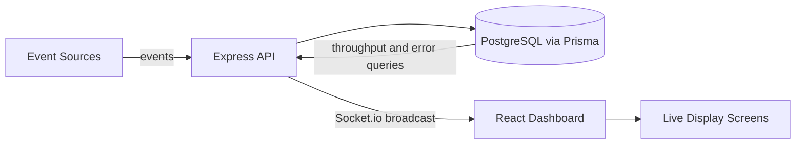
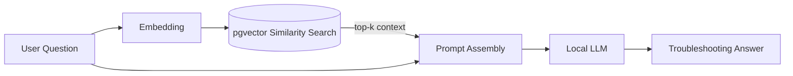
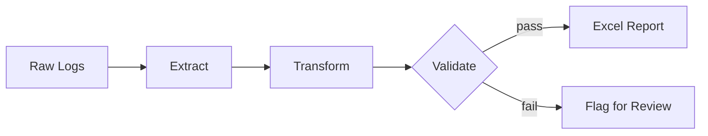

<!-- ===================== HEADER ===================== -->
<div align="center">


<a href="https://github.com/Iamrentoria211">
  
</a>

<br/>

<a href="https://juliusrentoria.vercel.app/"></a>
<a href="https://www.linkedin.com/in/juliusrentoria/"></a>
<a href="mailto:jrentoria211@gmail.com"></a>


</div>

<br/>

<!-- ===================== ABOUT ===================== -->
## About

Full-Stack Developer at **Kinpo Electronics (New Kinpo Group)**, based at FPIP, Sto. Tomas, Batangas, Philippines. I build scalable web applications, real-time monitoring systems, and internal workflow automation, and I am interested in the space where modern software architecture meets practical AI tooling.

```ts
const julius = {
  role: "Full-Stack Developer & Junior Software Engineer",
  company: "Kinpo Electronics (New Kinpo Group)",
  education: "B.S. Information Technology, FAITH Colleges (2025)",
  focus: ["Real-time systems", "Process automation", "Applied AI / RAG"],
  stack: ["TypeScript", "Node.js", "React", "Next.js", "PostgreSQL", "Python"],
  currentlyExploring: ["pgvector", "Ollama", "LM Studio", "Local inference workflows"],
  principle: "Eliminate the manual step, then make the result visible in real time.",
} as const;
```

<br/>

<!-- ===================== FOCUS AREAS ===================== -->
## Focus Areas

<table>
  <tr>
    <td width="50%" valign="top">
      <h3>Full-Stack Development</h3>
      Reactive, type-safe web applications and REST APIs built with TypeScript, Node.js, Express, React, and Next.js.
    </td>
    <td width="50%" valign="top">
      <h3>Process Automation</h3>
      RPA pipelines and desktop automation using Python, Power Automate Desktop, and AutoHotkey to remove redundant manual data work.
    </td>
  </tr>
  <tr>
    <td width="50%" valign="top">
      <h3>Real-Time Data Systems</h3>
      Live dashboards, event monitors, and WebSocket-driven reporting backed by PostgreSQL and Prisma.
    </td>
    <td width="50%" valign="top">
      <h3>Applied AI and Local LLMs</h3>
      Retrieval-Augmented Generation pipelines, vector search with pgvector, and local inference using Ollama and LM Studio.
    </td>
  </tr>
</table>

<br/>

<!-- ===================== TECH STACK ===================== -->
## Tech Stack

<div align="center">

| Layer | Technologies |
| :--- | :--- |
| **Languages** |  |
| **Frontend** |  |
| **Backend** |   |
| **Data** |   |
| **AI / LLM** |   |
| **Automation** |   |
| **Tooling** |  |
| **Other** |   |

</div>

<br/>

<!-- ===================== PROJECTS ===================== -->
## Featured Projects

### Real-Time Operations Monitor

Live monitoring dashboard that streams events, error tracking, and throughput statistics over WebSockets.

    

<details>
<summary><b>View architecture</b></summary>
<br/>



</details>

### ADA (AI Assistant)

Troubleshooting assistant powered by a RAG pipeline that combines PostgreSQL with pgvector and local LLM orchestration, so knowledge stays on-premises.

   

<details>
<summary><b>View architecture</b></summary>
<br/>



</details>

### Report Automation Suite

Python automation suite with a custom GUI that extracts, transforms, and validates raw log data into production-ready Excel reports.

  

<details>
<summary><b>View pipeline</b></summary>
<br/>



</details>

### FAITH ARbit

Augmented reality indoor campus navigation mobile app built with Unity and the Vuforia Engine.

  

<br/>

<!-- ===================== GITHUB ANALYTICS ===================== -->
## GitHub Analytics

<div align="center">

<picture>
  <source media="(prefers-color-scheme: dark)" srcset="https://github-readme-stats.vercel.app/api?username=Iamrentoria211&show_icons=true&theme=tokyonight&hide_border=true&bg_color=0d1117&count_private=true" />
  <source media="(prefers-color-scheme: light)" srcset="https://github-readme-stats.vercel.app/api?username=Iamrentoria211&show_icons=true&theme=default&hide_border=true&count_private=true" />
  
</picture>
<picture>
  <source media="(prefers-color-scheme: dark)" srcset="https://github-readme-stats.vercel.app/api/top-langs/?username=Iamrentoria211&layout=compact&theme=tokyonight&hide_border=true&bg_color=0d1117&langs_count=8" />
  <source media="(prefers-color-scheme: light)" srcset="https://github-readme-stats.vercel.app/api/top-langs/?username=Iamrentoria211&layout=compact&theme=default&hide_border=true&langs_count=8" />
  
</picture>

<br/><br/>

<picture>
  <source media="(prefers-color-scheme: dark)" srcset="https://streak-stats.demolab.com/?user=Iamrentoria211&theme=tokyonight&hide_border=true&background=0d1117" />
  <source media="(prefers-color-scheme: light)" srcset="https://streak-stats.demolab.com/?user=Iamrentoria211&theme=default&hide_border=true" />
  
</picture>

<br/><br/>

<picture>
  <source media="(prefers-color-scheme: dark)" srcset="https://github-readme-activity-graph.vercel.app/graph?username=Iamrentoria211&theme=tokyo-night&hide_border=true&bg_color=0d1117&area=true" />
  <source media="(prefers-color-scheme: light)" srcset="https://github-readme-activity-graph.vercel.app/graph?username=Iamrentoria211&theme=minimal&hide_border=true&area=true" />
  
</picture>

</div>

<br/>

<!-- ===================== SNAKE ===================== -->
<div align="center">

<picture>
  <source media="(prefers-color-scheme: dark)" srcset="https://raw.githubusercontent.com/Iamrentoria211/Iamrentoria211/output/github-snake-dark.svg" />
  <source media="(prefers-color-scheme: light)" srcset="https://raw.githubusercontent.com/Iamrentoria211/Iamrentoria211/output/github-snake.svg" />
  
</picture>

</div>

<br/>

<!-- ===================== CONNECT ===================== -->
## Connect

<div align="center">

| Channel | Link |
| :--- | :--- |
| **Portfolio** | [juliusrentoria.vercel.app](https://juliusrentoria.vercel.app/) |
| **LinkedIn** | [linkedin.com/in/juliusrentoria](https://www.linkedin.com/in/juliusrentoria/) |
| **Email** | [jrentoria211@gmail.com](mailto:jrentoria211@gmail.com) |

</div>


